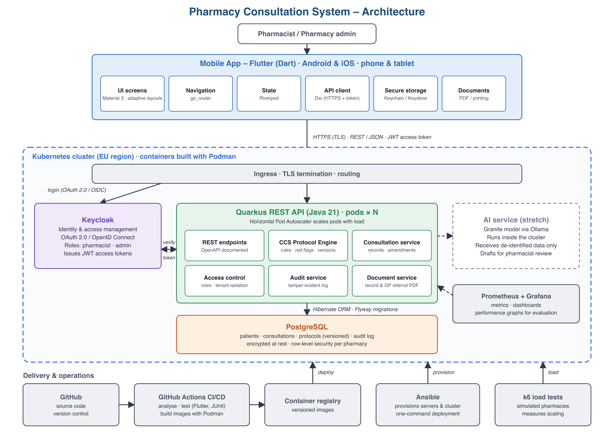

# RxFlow – Final Year Project

**A scalable, data-driven mobile system for structured community pharmacy consultations.**

RxFlow guides Irish community pharmacists through structured consultations under the **HSE Common Conditions Service (CCS)**, from patient details and medical history through red-flag screening, treatment and outcome, and produces a secure, auditable record of every consultation.

Final Year Project · Yi Jie Lim (20104720) · South East Technological University (SETU) · Supervisor: Richie Lyng

> ⚠️ **Academic prototype.** RxFlow is developed for research and education. It is not intended for clinical use, and it uses **synthetic (fake) patient data only**.

---

## The problem

Under the HSE Common Conditions Service, community pharmacists now assess and treat a range of common conditions. Most pharmacy software, however, is built for dispensing, prescriptions and stock management, not for guiding a pharmacist through a structured consultation. Consultations are often recorded on paper or in generic templates, which are slow, inconsistent and hard to audit, and make it easy to miss a red flag.

RxFlow started as a web prototype built in SETU's Startup Lab. That prototype proved the idea, but every condition was a hard-coded form, the red-flag decision was manual, and all data was stored in the browser. This project rebuilds it as a secure, scalable, multi-pharmacy system.

## Key features

- **Data-driven CCS protocol engine** – each condition's questions, branching logic, eligibility criteria, red flags and treatments are defined as data (JSON), not code. New conditions can be added without changing the application.
- **Automatic red-flag enforcement** – when a red-flag or referral criterion is met, treatment is blocked and a referral is required.
- **Protocol versioning** – every consultation stays linked to the protocol version used at the time.
- **Privacy by design (GDPR)** – encryption in transit and at rest, role-based access, data minimisation and EU hosting.
- **Tamper-evident audit trail** – records are amended, never overwritten, and every change is logged.
- **Multi-pharmacy isolation** – each pharmacy can only access its own patients and records.
- **Generated documents** – consultation records and GP referral letters as PDFs.
- **Cross-platform mobile app** – one Flutter codebase for Android and iOS, with layouts for both phones and tablets.
- **Cloud-native deployment** – containerised with Podman, deployed on Kubernetes with autoscaling, provisioned with Ansible, and delivered through a CI/CD pipeline.

## Architecture



| Component | Role |
|---|---|
| **Mobile app** (Flutter) | The interface pharmacists use on Android and iOS phones and tablets. Consultation screens are generated from the protocol data. |
| **Keycloak** | Login, user roles and access tokens (OAuth 2.0 / OpenID Connect). |
| **Quarkus REST API** | The backend: protocol engine, consultations, access control, audit and document services. Scales automatically on Kubernetes. |
| **PostgreSQL** | Patients, consultations, versioned protocols and the audit log, with row-level security per pharmacy. |
| **Prometheus + Grafana** | Metrics and performance dashboards. |
| **GitHub Actions, Podman, Kubernetes, Ansible** | Build, test, package and deploy the system. |

## Technology stack

| Layer | Technologies |
|---|---|
| Mobile app | Flutter, Dart, Material 3, go_router, Riverpod, Dio |
| Backend | Java 21, Quarkus, Hibernate ORM with Panache, Flyway, OpenAPI |
| Database | PostgreSQL |
| Security | Keycloak, OAuth 2.0 / OpenID Connect, TLS |
| DevOps | Podman, Kubernetes, Ansible, GitHub Actions |
| Testing and monitoring | flutter_test, JUnit 5, REST Assured, k6, Prometheus, Grafana |
| AI (stretch goal) | Granite model run locally via Ollama |

## Repository structure

```
.
├── mobile/        Flutter app (Android + iOS, phone + tablet)
├── backend/       Quarkus REST API (coming in Sprint 1)
└── docs/          Diagrams and project documentation
```

## Getting started

### Mobile app

Requirements: [Flutter](https://docs.flutter.dev/get-started/install) 3.x, Xcode (for iOS) and Android Studio (for Android).

```bash
cd mobile
flutter pub get
flutter run
```

### Backend

Instructions will be added once the Quarkus backend is set up.

## Project management

The project is run using **Scrum**, adapted for a one-person project, with 1–2 week sprints from October 2026 to April 2027. Work is tracked on a GitHub Projects board, with each user story linked to its functional (FR) or non-functional (NFR) requirement.

| Phase | Sprints | Focus |
|---|---|---|
| Planning and design | S0–S1 | Requirements, protocol schema, wireframes, CI |
| Core development | S2–S4 | Backend, protocol engine, mobile consultation flow |
| Semester 1 deliverables | S5–S6 | Records and PDFs, report, demo and presentation |
| Core development | S7–S9 | Audit, versioning, multi-pharmacy security, all CCS conditions |
| Cloud and scalability | S10–S11 | Kubernetes, Ansible, autoscaling, load testing, monitoring |
| Stretch and evaluation | S12–S14 | Stretch features, evaluation, final report and expo |

## Status

🚧 **In development** – currently in **Sprint 1** (19 October – 1 November 2026): designing the protocol format and data model, and setting up the backend and CI.

## Author

**Yi Jie Lim** – BSc Final Year Project, South East Technological University
